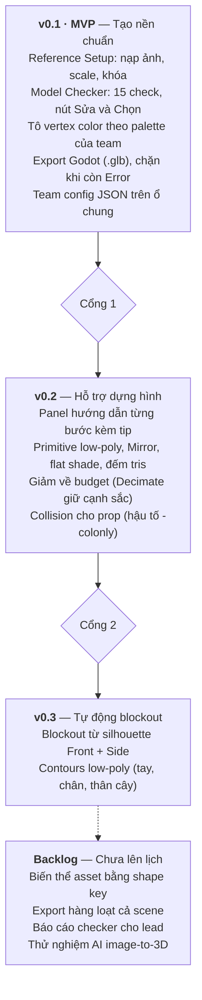

# LowPoly Kit – Plan & Spec

## Tổng quan

LowPoly Kit là add-on Blender giúp người mới trong team dựng asset low-poly đúng chuẩn, từ ảnh reference orthographic đến file `.glb` vào thẳng Godot.

**Vấn đề cần giải quyết**

- Setup ảnh ref thủ công dễ sai: scale giữa các view lệch nhau, ảnh bị click nhầm hoặc dịch chuyển.
- Người mới không biết dùng tool nào ở bước nào.
- Lỗi kỹ thuật (scale chưa apply, n-gon, vertex trùng, origin sai, vượt budget) chỉ lộ ra khi đã vào engine.
- Setting export và cách đặt tên mỗi người một kiểu.

**Người dùng**

- Artist mới (người dùng chính): cần được dẫn từng bước và biết mình sai ở đâu.
- Artist có kinh nghiệm: cần tốc độ, tắt được tip.
- Lead: đặt chuẩn một lần trong file config, cả team dùng chung.

**Chuẩn kỹ thuật**

| Hạng mục | Giá trị |
| --- | --- |
| Engine | Godot 4, file `.glb` |
| Loại asset | Nhân vật (CH), Prop (PR) |
| Budget | 1.000–15.000 tris mỗi asset |
| Tô màu | Vertex color, một material chung |
| Đơn vị | 1 unit Blender = 1 mét Godot |
| Blender | 4.2 LTS trở lên |

**Ngoài phạm vi:** texture, UV unwrap, sculpt high-poly, rig và animation (xem lại nếu nhân vật cần rig).

## Flow sử dụng

Người dùng mở sidebar (phím N) → tab **LowPoly Kit** và đi lần lượt 5 panel từ trên xuống. Ví dụ dưới đây: một bạn mới dựng thùng gỗ `PR_Barrel` từ ảnh Front và Side.

1. **Reference** (khoảng 1 phút)
   - Người dùng: chọn ảnh Front/Side/Back/Top, nhập chiều cao thật (0,9 m), bấm Tạo Reference.
   - Add-on: đặt ảnh đúng hướng, scale các view khớp nhau, đáy ảnh nằm trên mặt đất, khóa chọn, chỉ hiện ở view ortho tương ứng, gom vào collection `REF`. Có thanh opacity, nút ẩn/hiện và nút chuyển nhanh sang view Front/Side/Top.
2. **Dựng hình** (phần việc chính)
   - Người dùng: đặt tên asset, thêm primitive low-poly, dựng bằng tool có sẵn của Blender theo ảnh ref.
   - Add-on: báo tên đúng/sai và nhận loại asset, hiện số tris so với budget, preset Mirror và flat shade, tip theo bước (tắt được). Từ v0.3 có thêm tự sinh blockout.
3. **Tô màu**
   - Người dùng: vào Edit Mode, chọn face, click một ô trong palette.
   - Add-on: tự tạo color attribute và material `M_VertexColor`, ghi màu vào các face đang chọn. Palette lấy từ config chung của team.
4. **Kiểm tra**
   - Người dùng: bấm Kiểm tra model, xử lý danh sách lỗi.
   - Add-on: liệt kê lỗi theo mức Error / Warning / Info. Nút **Sửa** cho lỗi sửa an toàn được, nút **Chọn** bôi sẵn vùng lỗi trong Edit Mode để người mới tự sửa và học. Rê chuột để xem lý do.
5. **Export Godot**
   - Người dùng: bấm Export.
   - Add-on: chạy kiểm tra lại và chặn nếu còn Error, sau đó xuất `export/props/PR_Barrel.glb` với setting chuẩn cho Godot. Godot tự import, màu hiển thị đúng.

Lead chỉ cần sửa `team_config.json` trên ổ chung (budget, palette, convention); lần mở Blender tiếp theo cả team nhận chuẩn mới.

## Tính năng chi tiết

Sáu module. Model Checker là module giá trị nhất vì nó thay người senior rà lỗi.

### Reference Setup

- Nạp tối đa 4 ảnh: Front, Side (phải hoặc trái), Back, Top.
- Scale theo chiều cao thật: chiều cao ảnh Front/Side/Back = chiều cao nhập vào; ảnh Top scale theo độ rộng ảnh Front.
- Empty Image: hiển thị phía sau geometry, chỉ hiện khi nhìn thẳng trục, chỉ mặt trước, có alpha.
- Điều khiển: opacity, khóa/mở chọn, ẩn/hiện, xóa ref, nút chuyển view.
- Yêu cầu ảnh: cắt sát đỉnh và đáy vật thể; các view cùng tỷ lệ.

### Hỗ trợ dựng hình

- Hiển thị tris (sau modifier) của object đang chọn, thanh tiến độ so với budget.
- Primitive low-poly: cube, trụ 6/8 cạnh, cầu thấp.
- Preset Mirror X (clipping, bisect), flat shade, bật X-ray và Face Orientation.
- Tip ngắn cho từng bước, tắt được trong Preferences.

### Tô vertex color

- Tự tạo color attribute `Color` (theo góc face, 8-bit) và material chung `M_VertexColor`.
- Palette của team đọc từ config, có thêm một ô màu tự do.
- Tô các face đang chọn trong Edit Mode, hoặc cả object trong Object Mode.

### Model Checker

Mức Error chặn export; Warning và Info chỉ nhắc. "Sửa tất cả" chỉ chạy các bản sửa đánh dấu an toàn.

| Check | Mức | Sửa tự động | Chọn vùng lỗi |
| --- | --- | --- | --- |
| Tên sai convention / không rõ loại asset | Error | Không | – |
| Vượt budget tris (sau modifier) | Error; Warning khi ≥ 90% | Không (v0.2: giảm về budget) | – |
| Scale / rotation chưa apply | Error | Có (rotation bỏ qua nếu có Mirror) | – |
| Thiếu color attribute hoặc material vertex color | Error | Có | – |
| Origin không ở đáy-giữa | Warning | Có (giữ trục Mirror) | – |
| N-gon (> 4 cạnh) | Warning | Có, chia tam giác (không nằm trong Sửa tất cả) | Có |
| Vertex trùng | Warning | Có, merge theo khoảng cách | Có |
| Vertex / cạnh thừa (loose) | Warning | Có, xóa | Có |
| Normal không nhất quán hoặc lật ngược | Warning | Có, recalculate outside | Có |
| Face diện tích bằng 0 | Warning | Có, dissolve | Có |
| Cạnh dính hơn 2 face (non-manifold) | Warning | Không | Có |
| Nhiều hơn 1 material | Warning | Có, thay bằng `M_VertexColor` | – |
| Face đang smooth shading | Info | Có, flat shade | – |
| Tên mesh data khác tên object | Info | Có, đổi tên | – |
| Chưa tô màu (toàn một màu) | Info | Không | – |

### Export Godot

- Định dạng `.glb`, Y-up, apply modifier, kèm vertex color qua material.
- Đưa object về gốc tọa độ khi export rồi trả lại vị trí cũ; xuất cả object con.
- Đường dẫn: `<export_dir>/<characters|props>/<Tên object>.glb`; yêu cầu đã lưu file `.blend`.
- Chạy Model Checker trước; còn Error thì từ chối và mở danh sách lỗi.
- Cảnh báo nếu unit scale của scene khác 1.

### Team config

- File `team_config.json`; đường dẫn chỉnh trong Preferences của add-on (trỏ ra ổ chung). Không có file thì dùng bản mặc định đi kèm.
- Nội dung: loại asset (tiền tố, budget, thư mục export), regex tên, tên material và color attribute, số material tối đa, khoảng cách merge, thư mục export, palette màu.
- Tự nạp lại khi file thay đổi; config lỗi thì báo trong Preferences và dùng mặc định.

## Tự động dựng mesh

Add-on tự động hóa phần blockout, không dựng hoàn chỉnh model. Ảnh ortho chỉ cho silhouette, không cho độ sâu chi tiết; và vẻ đẹp của low-poly nằm ở quyết định đặt cạnh — việc của artist.

| Mức | Cách làm | Phiên bản | Kết quả mong đợi |
| --- | --- | --- | --- |
| Blockout từ silhouette | Lấy viền ảnh Front và Side (alpha hoặc nền trơn) → đơn giản hóa đường viền → đùn thành khối → Boolean giao 2 khối | v0.3 | Đúng tỷ lệ tổng thể; topology thô, cần dựng lại |
| Contours low-poly | Vẽ một nét dọc tay/chân/thân cây ở view ortho, chọn 6 hoặc 8 cạnh → sinh chuỗi trụ khớp độ rộng ảnh ref | v0.3 | Gần dùng được ngay |
| Giảm về budget | Nhập số tris mục tiêu → Decimate, giữ cạnh sắc và ranh giới màu | v0.2 | Ổn với prop; nhân vật cần dọn lại |
| AI image-to-3D | Gọi dịch vụ ngoài (Meshy, Tripo, Hunyuan3D, TRELLIS...) → import → giảm về budget | Backlog, thử nghiệm | Mesh dày và lộn xộn; chỉ dùng làm nguồn blockout. Tốn phí API, cần xem bản quyền |

Hai mức đầu đáng làm nhất: cắt phần lớn thời gian blockout của người mới mà vẫn để họ kiểm soát hình khối. Điều kiện: ảnh ref nền trong suốt hoặc nền trơn, cắt sát vật thể.

## Tham khảo add-on khác

RetopoFlow cho ý tưởng hữu ích nhất (Contours); Quad Remesher cho ý tưởng "đặt mục tiêu số poly"; Sculpt Layers ít liên quan vì team không sculpt. Không tích hợp trực tiếp add-on nào — cả ba đều trả phí.

| Add-on | Ý tưởng | Áp dụng cho LowPoly Kit | Ưu tiên |
| --- | --- | --- | --- |
| [RetopoFlow 4](https://superhivemarket.com/products/retopoflow?variant=15422) | Contours: sinh vòng cạnh quanh hình trụ (tay, chân, ngón) | Contours low-poly vẽ trên view ortho, 6–8 cạnh, khớp ảnh ref | Cao (v0.3) |
| RetopoFlow 4 | Tool nằm ngay trong Edit Mode, tự snap lên bề mặt (PolyStrips, PolyPen, Strokes) | Dùng Poly Build, Snap to Face, Shrinkwrap có sẵn của Blender; add-on chỉ preset và hướng dẫn | Trung bình (v0.2) |
| [Quad Remesher](https://www.exoside.com/quadremesherdata/QuadRemesher_1.3_UserDoc.pdf) | Nhập số poly mục tiêu; vẽ vùng mật độ; giữ cạnh sắc và ranh giới material | Giảm về budget bằng Decimate, giữ cạnh sắc và ranh giới màu vertex color | Trung bình (v0.2) |
| Quad Remesher | Engine auto-retopo ra quad | Không áp dụng: engine đóng, nhắm tới high-poly | – |
| [Sculpt Layers](https://superhivemarket.com/products/sculpt-layers-non-destructive-sculpt-layers-with-masks-and-strength-sliders-for-blender) | Layer không phá hủy lưu bằng shape key, có strength và mask | Biến thể asset (prop vỡ/cũ, nhân vật mập/gầy) bằng shape key | Thấp (backlog) |

Godot 4 tự sinh LOD khi import, nên không cần tool LOD.

## Lộ trình



| Cổng | Tiêu chí (đề xuất) |
| --- | --- |
| Cổng 1 (v0.1 → v0.2) | Hai bạn mới tự làm xong 1 prop từ ảnh ref đến `.glb`, không cần senior |
| Cổng 2 (v0.2 → v0.3) | Feedback v0.1 đã xử lý; mọi asset qua checker import vào Godot không lỗi |

Mỗi phiên bản chỉ bắt đầu khi qua cổng của phiên bản trước; tiêu chí cổng là đề xuất, team có thể sửa. Chưa đặt ngày vì còn chờ chốt quyết định ở mục cuối.

## Kiến trúc kỹ thuật

Một package Python thuần, không phụ thuộc thư viện ngoài, phát hành dạng Blender Extension (4.2+).

```
lowpoly_kit/
  blender_manifest.toml   # metadata extension
  __init__.py             # register/unregister các module
  config.py               # đọc team_config.json, Preferences
  reference.py            # Reference Setup
  modeling.py             # primitive, Mirror, flat shade, đếm tris
  coloring.py             # palette, tô vertex color, material
  checks.py               # Model Checker: check, fix, select
  export.py               # export glTF cho Godot
  ui.py                   # 5 panel trong sidebar
  team_config.json        # config mặc định / mẫu cho lead
```

**Nguyên tắc**

- Check và fix dùng `bmesh` trên dữ liệu mesh; chỉ gọi `bpy.ops` cho export và chuyển mode, để ít phụ thuộc context.
- Check đăng ký theo bảng (id → hàm check, hàm fix, hàm select, cờ an toàn): thêm check mới không phải sửa UI.
- Tris đếm trên mesh đã qua modifier (đúng với file export); lỗi topology kiểm trên mesh gốc (đúng chỗ người dùng sửa).
- Mọi fix đều undo được (Ctrl+Z).
- Option của exporter glTF được dò theo phiên bản Blender, tránh lỗi khi Blender đổi tên tham số.

**Phân phối:** bản đầu gửi file zip (Install from Disk). Sau đó có thể dựng extension repository nội bộ để Blender tự báo bản mới.

**Kiểm thử:** script chạy Blender chế độ nền (`blender -b`) tạo mesh lỗi mẫu cho từng check, xác nhận check bắt được và fix sửa được; export rồi import thử vào Godot 4.

## Quyết định, rủi ro, bước tiếp theo

Cần chốt 6 điểm dưới đây trước khi code v0.1; cột Đề xuất là giá trị mặc định nếu team không có ý kiến khác.

| Quyết định | Đề xuất | Ảnh hưởng |
| --- | --- | --- |
| Naming convention | Object `CH_Knight`, `PR_Barrel_Broken`; material `M_VertexColor`; file `export/<characters\|props>/<Tên>.glb` | Checker, Export |
| Budget theo loại | CH 15.000, PR 15.000 (có thể hạ prop nhỏ xuống 3.000) | Checker |
| Vị trí origin | Đáy, chính giữa (chân nhân vật, đáy prop) | Checker, Export |
| Nhân vật có rig/armature? | Chưa hỗ trợ trong v0.1 | Export |
| Ngôn ngữ UI | Tiếng Việt (thuật ngữ Tiếng Anh) | Toàn bộ UI |
| Cách phát hành | Zip trước, repository nội bộ sau | Vận hành |

**Rủi ro**

| Rủi ro | Giảm thiểu |
| --- | --- |
| Checker quá khắt khe làm người mới nản | Chỉ Error chặn export; ngưỡng chỉnh được trong config |
| Ảnh ref bẩn làm hỏng scale và blockout tự động | Đưa quy chuẩn ảnh ref (nền trong suốt, cắt sát, cùng tỷ lệ) vào guideline của team ngay từ đầu |
| Fix tự động phá model (apply rotation khi có Mirror, dời origin) | Fix không an toàn không nằm trong Sửa tất cả; mọi fix undo được |
| Blender đổi API giữa các phiên bản | Khóa bản tối thiểu 4.2 LTS; dò option exporter theo phiên bản |
| Vertex color không hiện trong Godot | Kiểm thử import thật; hướng dẫn bật Vertex Color > Use as Albedo nếu cần |

**Bước tiếp theo**

- [ ] Team chốt 6 quyết định ở bảng trên
- [ ] Chuẩn bị 2–3 bộ ảnh ref mẫu (1 nhân vật, 1–2 prop) để test
- [ ] Code v0.1 theo spec này
- [ ] 1–2 bạn mới dùng thử trên asset thật, thu feedback
- [ ] Chốt phạm vi v0.2
